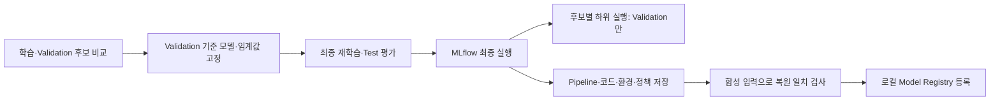

# 은행 고객 이탈 예측 — 고객 선별과 재현 가능한 평가

수업의 Bank Churn 실습을 기반으로, 제한된 연락 예산 안에서 이탈 위험 고객을 선별하는 개인 포트폴리오입니다. 이탈 예측 프로젝트이며 이상거래 탐지는 다루지 않습니다.

## 이번 개인 고도화 (2026-10-29)

| 기존 문제 | v2 변경 |
|---|---|
| 후보 모델마다 Test 점수 확인, Validation/Test 평균 표시 | Validation에서만 모델·임계값 선택, 최종 재학습 모델이 Test에서 한 번만 예측 |
| 파생변수 함수가 학습·신규 고객 처리에 따로 존재 | 원시 컬럼 → 파생변수 → 결측값·인코딩·스케일링 → 분류기를 Pipeline 하나로 저장 |
| baseline 선정 후에도 FE 입력으로 재학습할 가능성 | 선택한 Pipeline 전체를 clone/refit해 baseline/FE 설정을 보존 |
| AUC 중심 결과 | 상위 10% Precision·Recall·Lift와 AP, F2·혼동행렬을 함께 기록 |
| 개인 컴퓨터 절대 경로 의존 | 경로를 받는 CLI와 같은 모듈을 호출하는 노트북 |
| 고객별 데이터·점수·모델이 Git에 포함 | 현재 버전에서는 제외, 집계 지표와 재현 가능한 합성 데이터 생성 코드만 공개 |

제공 실습을 기반으로 한 응용이며 전체를 독자 작성했다고 주장하지 않습니다. `모델개발및최적화.ipynb`, 과거 발표 대본과 `reports/historical-v1.csv`는 기존 기록입니다. 현재 실행 경로는 `churn/`이며 과거 점수와 새 점수를 동일 조건의 개선율로 비교하지 않습니다.

## 빠른 실행 — API 키·GPU 불필요

Python 3.11 환경에서 프로젝트 루트 기준:

```bash
python3.11 -m venv .venv
source .venv/bin/activate
python -m pip install -r requirements.txt
python -m churn.demo --output data/demo.csv --rows 1000
python -m churn.train train --data data/demo.csv --output artifacts/demo-run
python -m unittest discover -s tests -v
```

위 demo는 직접 생성한 가상 데이터입니다. 실행 확인용이며 아래 실제 교육 데이터의 결과를 재현하지 않습니다. 이미 존재하는 데이터·실험 폴더·출력 파일은 덮어쓰지 않습니다. 반복할 때 새 출력 이름을 지정하세요. 외부 API·네트워크 호출은 학습·평가 코드에 없습니다.

## 교육 데이터로 학습·신규 고객 처리

이용 가능한 교육용 `bank_churn_train.csv`, `bank_churn_new.csv`를 `data/`에 별도로 준비합니다. 교육용 날짜 컬럼이 추가된 자료라 다른 Bank Churn 공개 CSV와 스키마가 같다고 가정하지 않습니다. 기존 체크아웃에 남아 있는 루트 CSV는 `--data bank_churn_train.csv`로 사용할 수 있습니다.

```bash
python -m churn.train train --data data/bank_churn_train.csv --output artifacts/bank-run
python -m churn.train score --data data/bank_churn_new.csv --model artifacts/bank-run/model.joblib --output outputs/new-customer-scores.csv
```

학습에는 `Exited`(0=유지, 1=이탈)와 고유한 `CustomerId`가 필요합니다. 같은 고객의 여러 스냅샷을 무작위로 나누지 않도록 중복 ID는 거부합니다. 점수화에는 정답이 필요 없으며 ID는 출력 매칭에만 사용합니다. 모델이 사용하는 컬럼은 다음과 같습니다.

- 수치: CreditScore, Age, Balance, NumOfProducts, HasCrCard, IsActiveMember, EstimatedSalary
- 범주: Geography, Gender
- FE 사용 시 날짜: baseDate, accountOpeningDate

성씨·ID·정답·예상하지 않은 추가 컬럼은 입력에서 제외합니다. 날짜 해석 실패·미래 개설일·0 이하 나이의 파생값은 결측값으로 처리하고, 학습 데이터에서 학습한 대체값을 사용합니다. 필수 컬럼 누락·잘못된 수치·무한대 입력은 실패시킵니다. 처음 보는 범주도 처리합니다.

출력의 `churn_score`는 보정된 실제 이탈 확률을 보장하지 않는 모델 점수입니다. `risk_flag`는 Validation F2 기준 임계값을 넘는지 표시하고, `contact_selected`는 점수가 높은 순서대로 **floor(고객 수 × 연락 비율)**명만 선택합니다. 두 정책을 같은 것으로 해석하지 않습니다. 동점은 입력 행 순서를 사용하며, 10명 미만에서 10% 예산은 0명입니다. 고객별 점수와 joblib은 로컬에만 저장합니다. joblib 로딩은 본인이 생성한 신뢰할 수 있는 파일에만 사용하세요.

## 평가 절차

1. seed 42, 고객 단위 단일 스냅샷을 층화 60/20/20으로 분리합니다.
2. Train에서 Logistic Regression, RF baseline, 같은 RF+FE, 얕은 RF+FE, XGBoost+FE를 학습합니다. 자동 대규모 탐색은 하지 않습니다.
3. Validation의 상위 10% Precision → AP → ROC-AUC 순으로 모델을 선택합니다. 동률이면 모델 이름 순입니다. baseline/FE RF는 같은 설정으로 비교합니다.
4. 선택 후보의 Validation 점수에서 F2를 최대화하는 임계값을 고정합니다. 동률이면 높은 임계값을 사용합니다.
5. 선택 Pipeline을 Train+Validation으로 재학습하고, Test에서 한 번만 예측합니다. Test는 후보 선택·임계값 조정·조기 종료에 쓰지 않습니다.
6. 같은 고정 Test 예측으로 지표·95% bootstrap 구간·5/10/20% 예산 곡선을 계산합니다. 이 곡선은 사후 설명용이며 Test 결과를 보고 정책을 재조정하지 않습니다.

AP는 average precision이며 사다리꼴 적분 PR-AUC와 동일하지 않습니다. preprocessing 일관성과 데이터 분리는 [scikit-learn 공식 권고](https://scikit-learn.org/stable/common_pitfalls.html)를 참고했고, 분류 지표는 [공식 평가 문서](https://scikit-learn.org/stable/modules/model_evaluation.html)를 참고했습니다.

## 이번 실행 결과 — 교육 데이터 2,100명

집계 결과 전체: [reports/churn-v2.json](reports/churn-v2.json). 같은 seed의 기존 데이터로 새 절차를 실행한 후향 분석입니다. 개인별 예측은 포함하지 않습니다.

| Validation 후보 | 상위 10% Precision | AP | ROC-AUC |
|---|---:|---:|---:|
| XGBoost + FE (선택) | 0.8095 | 0.7194 | 0.8771 |
| 얕은 RF + FE | 0.7619 | 0.6433 | 0.8419 |
| RF + FE | 0.7381 | 0.6487 | 0.8548 |
| RF baseline | 0.7143 | 0.6340 | 0.8600 |
| Logistic Regression + FE | 0.5238 | 0.5014 | 0.7727 |

최종 Test는 420명(이탈 89명)입니다. 최종 모델은 XGBoost + FE이며 Train+Validation 1,680명으로 재학습했습니다.

| 최종 Test 지표 | 결과 |
|---|---:|
| ROC-AUC | 0.8568 |
| Average Precision | 0.6789 |
| 상위 42명 중 실제 이탈 고객 | 34명 |
| Precision@10% | 80.95% |
| Recall@10% | 38.20% |
| Lift@10% | 3.82 |
| 무작위로 42명 선택 시 기대 이탈 고객 수 | 8.9명 |

Validation에서 선택한 F2 임계값은 약 0.1785입니다. 이 임계값 정책의 Test Precision은 44.30%, Recall은 78.65%로, 연락 예산 10% 정책과 다른 결과입니다. Test ROC-AUC의 bootstrap 95% 구간은 약 0.8140~0.8998이며 학습·모델 선택 변동성을 포함하지 않습니다.

신규 고객 900명을 저장한 모델로 별도 점수화해 원시 입력 호환성을 확인했습니다. 신규 고객의 정답은 평가하지 않았으며 신규 데이터 정확도 검증을 의미하지 않습니다.

## 검증과 한계

검사 8종: 개인정보·정답의 입력 제외, 결측/처음 보는 범주/잘못된 날짜, 스키마·무한대 입력 거부, 추론 시 전처리 재학습 방지, baseline/FE 저장·복원 일치, 연락 예산·동점 규칙, 분할 격리·최종 모델만 Test 접근, 고객 중복·라벨 검증. 검사에는 합성 자료만 사용합니다.

- 이 데이터는 이전 실습에서 이미 탐색했습니다. 절차를 고쳐도 완전히 새로운 외부 홀드아웃이 되지는 않습니다.
- 기준일이 하나인 스냅샷 자료라 미래 시점 성능을 입증하지 않습니다. 새로운 기간·고객 cohort를 별도로 평가해야 합니다.
- Validation에서 연락 대상은 42명뿐이라 모델 선택이 불안정할 수 있습니다. 단일 split의 우승을 보편적인 우위로 확대하지 않습니다.
- 이탈 위험과 캠페인 반응은 다릅니다. 연락 효과·고객 유지 수익·비용 정보가 없어 uplift나 실제 순이익은 주장하지 않습니다.
- 원본 CSV·고객별 출력·모델·과거 제출 바이너리는 현재 추적에서 제외했습니다. **기존 공개 커밋에서 소급 삭제한 것은 아닙니다.** 로컬 파일은 보존했습니다.

다음 개선 후보는 시간 기준 신규 데이터 검증, 반복 분할에서의 선택 안정성, 점수 보정, 캠페인 효과 데이터 기반 의사결정입니다. 우선은 현재 절차와 공개 결과를 재현할 수 있게 유지합니다.


## 개인 고도화 2 — 로컬 MLflow 실험·모델 관리

2026-10-29에 수업에서 다룬 MLflow Tracking·Model Registry 흐름을 연결했습니다. 기존 학습·평가가 끝난 뒤 기록을 시작하며, Tracking을 선택하지 않으면 기존 CLI 그대로 동작합니다. 이번 단계는 모델 관리이며 FastAPI 서빙·실제 배포를 의미하지 않습니다.



### 설치와 실행

기본 의존성과 별도로 MLflow 3.16.0을 설치합니다. API 키·클라우드 계정은 필요 없습니다.

```bash
python -m pip install -r requirements-tracking.txt
python -m churn.train train --data data/demo.csv --output artifacts/demo-tracked --tracking-dir artifacts/mlflow --experiment bank-churn-demo
python -m churn.tracking --run-dir artifacts/demo-tracked --tracking-dir artifacts/mlflow --experiment bank-churn-demo
```

`data/demo.csv`는 앞 절의 `churn.demo` 명령으로 생성합니다. 실데이터를 준비했다면 `--data`와 실험 이름을 변경합니다. 같은 출력 폴더를 재사용하지 않습니다. 노트북에서도 `CHURN_TRACKING_DIR=artifacts/mlflow`를 설정하면 같은 모듈을 통해 기록합니다.

별도 터미널에서 프로젝트 루트를 열고 화면을 실행합니다.

```bash
source .venv/bin/activate
export MLFLOW_DISABLE_TELEMETRY=true
export MLFLOW_ENABLE_OTLP_EXPORTER=false
export MLFLOW_DISABLE_AGENT_HINT=1
mlflow ui --backend-store-uri sqlite:///artifacts/mlflow/tracking.db --host 127.0.0.1 --port 5055 --workers 1
```

브라우저 주소: `http://127.0.0.1:5055`. 종료는 해당 터미널에서 Ctrl+C입니다. Tracking 프로그램은 SQLite DB와 file 아티팩트 경로를 직접 지정하므로 UI 서버가 꺼져 있어도 기록·등록·복원 검사를 실행할 수 있습니다. 기존 원격 Tracking/Registry 환경변수는 이 로컬 실행에서 사용하지 않습니다.

### 화면에서 확인할 것

- **Experiments → bank-churn**: `selected-final` 상위 실행과 후보 5개의 하위 실행을 봅니다. `phase=candidate` 실행의 `validation_precision_at_budget`, `validation_average_precision`, `validation_roc_auc`를 비교합니다. 후보 실행에 Test 지표는 기록하지 않습니다.
- **selected-final**: 데이터 SHA-256, seed, 분할 건수·방법, 선택 기준, F2 임계값, 최종 Test 지표와 `report.json`을 확인합니다.
- **Models → BankChurnPipeline**: 선택된 Pipeline의 버전과 코드·환경 명세를 확인합니다. `deployment=not_deployed`이며 production/champion 별칭을 자동 부여하지 않습니다.
- **decision_policy.json / 모델 metadata**: 임계값·연락 비율을 별도로 보존합니다. sklearn 모델의 기본 `predict()` 결과를 이 정책의 risk_flag로 혼동하지 않습니다. MLflow pyfunc flavor는 두 클래스의 `predict_proba`를 반환하도록 설정했습니다.

### 저장·검증·보안 범위

`artifacts/mlflow/tracking.db`에 실행·등록 메타데이터, 같은 폴더 아래 `artifacts/`에 Pipeline·애플리케이션 코드·환경·집계 결과를 저장합니다. 실행 폴더의 `mlflow.json`은 로컬 run ID와 고정 Registry 버전을 연결합니다. 이 파일과 MLflow DB·모델은 Git에 올리지 않습니다.

원본 고객 행·개인별 점수·고객 ID·성씨를 로그하지 않고, autologging·input_example·원본 데이터셋 로깅도 사용하지 않습니다. 모델 signature는 실제 고객 대신 직접 생성한 합성 입력 8행으로 구성합니다. 원격 아티팩트 URI나 지정 Tracking 폴더 밖을 가리키는 기존 실험은 거부합니다. SDK와 UI의 사용량 telemetry는 끕니다.

직접 작성한 전처리 클래스를 포함하므로 모델은 cloudpickle 형식으로 저장합니다. 기존 joblib과 마찬가지로 **본인이 생성한 신뢰할 수 있는 로컬 아티팩트만 로드**합니다. 이 버전의 MLflow 기본 skops 형식에서는 사용자 정의 전처리의 신뢰 타입 검토가 별도로 필요합니다. 이 앱은 신뢰할 수 없는 모델을 받는 업로드 기능을 제공하지 않습니다.

합성 입력에서 원본 Pipeline, MLflow 아티팩트 복원본, 고정 Registry 버전 복원본의 점수가 atol=1e-12 안에서 일치해야 합니다. 첫 복원 검사가 실패하면 Registry 버전을 생성하지 않으며, 기록 도중 실패한 실행은 FAILED로 남습니다. 학습·평가 도중 실패를 실시간으로 추적하는 기능은 아직 없습니다.

이번 실행의 공개 집계 검증: [reports/mlflow-verification.json](reports/mlflow-verification.json).

- MLflow 설치 환경에서 **검사 12개 통과**, integration 검사 생략 0개. 선택 의존성이 없으면 해당 API/MLflow 검사는 명시적으로 생략합니다.
- 교육 데이터 실험에서 후보 실행 5개 + 최종 실행 1개, 후보의 Test 지표 기록 0개를 확인했습니다. 기존 v2와 최종 Test 집계 지표도 일치했습니다.
- 아티팩트·Registry 복원 및 별도 Python 프로세스 재검증의 최대 점수 차이는 **0.0**이었습니다. 합성 입력의 직렬화 일치 검사이며 미래 고객 성능을 증명하지 않습니다.
- MLflow UI와 실험 목록 조회의 HTTP 200을 확인했습니다. MLflow 검증 환경은 로컬 macOS/ARM64, Python 3.14.7입니다. 기존 v2 학습 결과의 Python 3.11 환경과 구분합니다.

참고: [MLflow Tracking](https://mlflow.org/docs/latest/ml/tracking/quickstart/), [sklearn 모델 저장](https://mlflow.org/docs/latest/api_reference/python_api/mlflow.sklearn.html), [Model Registry](https://mlflow.org/docs/latest/ml/model-registry/workflow/), [telemetry 설정](https://mlflow.org/docs/latest/community/usage-tracking/).


## 개인 고도화 3 — FastAPI 점수화·고객군 선정 API

저장된 모델을 로컬 HTTP 서비스로 연결했습니다. 아래는 API를 Python으로 직접 실행하는 방법이며, Docker Compose 실행은 다음 절을 참고합니다. Vue 화면·외부 공개 배포는 아직 추가하지 않았습니다.

### 실행과 호출

```bash
python -m pip install -r requirements-api.txt
python -m churn.train train --data data/demo.csv --output artifacts/api-demo
CHURN_MODEL_PATH=artifacts/api-demo/model.joblib uvicorn churn.api:app --host 127.0.0.1 --port 8061 --workers 1 --no-access-log
```

`data/demo.csv`가 없으면 앞 절의 `churn.demo` 명령으로 생성합니다. 실제로 준비한 모델을 쓰려면 `CHURN_MODEL_PATH`만 해당 로컬 bundle 경로로 지정합니다. MLflow 설치·서버가 없어도 API가 동작합니다. 모델은 시작할 때 한 번만 읽고 실행 중에는 바뀌지 않으며, 교체 후 재시작해야 합니다. 경로가 없거나 모델이 잘못되면 프로세스는 살아 있지만 준비 상태·점수화는 503을 반환합니다.

Swagger UI: `http://127.0.0.1:8061/docs`. 별도 터미널에서:

```bash
curl http://127.0.0.1:8061/health
curl http://127.0.0.1:8061/ready
curl -X POST http://127.0.0.1:8061/api/v1/scores -H 'Content-Type: application/json' --data-binary @api/examples/scores.json
curl -X POST http://127.0.0.1:8061/api/v1/contact-selections -H 'Content-Type: application/json' --data-binary @api/examples/cohort.json
```

예제 JSON은 직접 생성한 합성 고객이며 실제 고객 정보가 아닙니다. API 계약은 [api/contract.md](api/contract.md), OpenAPI는 [api/openapi.json](api/openapi.json)입니다. OpenAPI 파일은 Postman에도 가져올 수 있습니다. 코드 변경 후 `python -m churn.api --export-openapi api/openapi.json`으로 갱신하며 테스트가 저장된 계약과의 차이를 확인합니다.

| 기능 | 의미 |
|---|---|
| /health | 프로세스 생존 상태 |
| /ready | 신뢰 가능한 모델의 로드·출력 검사 완료 여부 |
| /api/v1/scores | 1~1,000명 점수·risk_flag 반환. 부분 배치 가능, 연락 대상 선정 없음 |
| /api/v1/contact-selections | 1~5,000명의 완전한 **선언된** 고객군을 한 번에 제출해 연락 대상 선정 |

scores의 risk_flag는 저장된 F2 임계값 기준이며, contact_selected와 다릅니다. 선정 API는 모델에 저장된 연락 비율을 사용하고 요청에서 바꿀 수 없습니다. 예상 고객 수가 실제 전달 수와 다르면 거부하며, 상위 floor(N × 비율)명을 선택합니다. 동점은 CustomerId 오름차순으로 처리해 입력 행 순서가 바뀌어도 선정 결과가 같습니다. 기존 CLI는 동점에서 입력 순서를 사용하므로 그 규칙과 구분합니다.

서버는 고객군을 보관하거나 여러 요청을 합치지 않고 업무 DB의 실제 전체 고객 수도 알지 못합니다. expected_customer_count는 호출자의 선언을 검증하는 것이며 실제 모집단 완전성을 보증하지 않습니다. 5,000명보다 큰 고객군을 여러 선정 요청으로 나누면 전체 예산 선정이 되지 않으므로 별도 스냅샷·분할 업로드 설계가 필요합니다. cohort_id는 저장·중복 방지 키가 아닙니다.

### 검증과 운영 범위

```bash
python -m unittest discover -s tests -v
python -m churn.api_check --url http://127.0.0.1:8061 --model artifacts/api-demo/model.joblib --output artifacts/api-live-check.json
```

검증기는 합성 고객 23명만 보내고 로컬 Pipeline과 HTTP 결과를 비교합니다. 버전·임계값·연락 예산·전체 순위·부분 고객군 거부·오류 값 비노출·OpenAPI 조회 등 11개 검사를 수행합니다. 출력은 집계 결과이며 개별 고객 점수를 저장하지 않습니다. 본인이 만든 모델만 검증에 사용합니다.

[API 검증 집계](reports/api-verification.json): API 검사 13개와 기존 검사를 합쳐 **25개 통과, 생략 0개**. 저장된 XGBoost 모델을 실제 로컬 서버에 로드해 HTTP 검사 11개도 통과했고 점수의 최대 차이는 **0.0**이었습니다. API만 설치하면 MLflow 통합 검사 3개는 생략합니다.

입력 검사는 중복 ID·필수 필드·유한 숫자·유효 날짜·플래그·크기 제한을 포함합니다. null과 처음 보는 범주는 Pipeline의 결측값·인코딩 처리로 연결합니다. Surname·Exited·추가 필드는 거부하고 오류에 입력 값·예외 원문·모델 경로를 노출하지 않습니다. 모델 추론 실패를 성공 응답으로 바꾸지 않습니다. 본문은 실제 수신 바이트까지 2 MiB로 제한하며 chunked 전송도 검사합니다.

model_version은 로드한 파일의 SHA-256으로 실제 실행 아티팩트를 구분하며 MLflow Registry 버전 번호와는 다릅니다. 서버는 로컬 모델만 읽고 원격 Registry나 외부 API를 호출하지 않습니다. 모델 업로드·재학습·입력/출력 저장·본문 로깅은 제공하지 않습니다. 인증 없는 로컬 개인용 API이므로 localhost에만 바인딩하며 공용망 노출·인증·부하 용량은 검증하지 않았습니다. 실제 이탈 확률 보정이나 캠페인 효과도 보장하지 않습니다.

참고: [FastAPI lifespan](https://fastapi.tiangolo.com/advanced/events/), [오류 처리](https://fastapi.tiangolo.com/tutorial/handling-errors/), [Pydantic strict mode](https://docs.pydantic.dev/latest/concepts/strict_mode/).


## 개인 고도화 4 — Docker Compose와 상태 복구

API와 MLflow를 같은 이미지·같은 상태 볼륨으로 실행합니다. **기본 구성은 합성 데모 전용**이며, 앞에서 금융 교육 데이터로 학습한 호스트 모델을 자동 복사하거나 운영 모델로 배포하지 않습니다. 실제 금융 데이터 성능과 합성 데모 성능을 구분합니다.

### 첫 실행

Docker와 Compose를 준비한 뒤 프로젝트 루트에서:

```bash
docker compose up -d --build --wait --wait-timeout 180
docker compose ps
```

- API와 Swagger: `http://127.0.0.1:8061/docs`
- MLflow: `http://127.0.0.1:5055` → `compose-demo` 실험

최초 이미지 빌드에는 패키지 다운로드가 필요합니다. 첫 초기화는 고정 seed의 합성 고객 1,000명을 생성해 기존 후보 비교·최종 평가·MLflow 등록을 한 번 수행합니다. 이후 같은 볼륨에서는 모델 해시와 Registry 복원을 확인하고 재학습하지 않습니다. 불완전하거나 변조된 상태를 발견하면 기존 파일을 덮어쓰지 않고 실패합니다. 초기화가 성공해야 API와 MLflow가 시작됩니다.

포트가 사용 중이면 호스트 포트만 바꿀 수 있습니다.

```bash
CHURN_API_PORT=8062 CHURN_MLFLOW_PORT=5056 docker compose up -d --build --wait
```

컨테이너의 `0.0.0.0` 리스닝은 Docker 내부용이고, 호스트 공개 포트는 IPv4 localhost로만 바인딩합니다. 표준 Compose 네트워크를 사용하며 별도의 외부 통신 차단 정책은 구현하지 않습니다. 모델·LLM API·클라우드·GPU는 외부 서비스로 호출하지 않습니다.

### 서비스와 저장 공간

| 서비스 | 역할 | 상태 접근 |
|---|---|---|
| init | 합성 데모 초기화 또는 기존 상태 검증, 완료 후 종료 | /state 읽기·쓰기 |
| api | /ready 기반 healthcheck, 점수화·고객군 선정 | /state 읽기 전용 |
| mlflow | 실험·모델 조회, DB 조회 기반 healthcheck | /state 읽기·쓰기 |

`churn-state` named volume에 데이터·모델·MLflow DB·아티팩트를 함께 저장합니다. 모든 컨테이너에서 경로를 `/state`로 유지해 MLflow의 로컬 아티팩트 URI가 일치하게 합니다. API는 `/state/runs/demo-v1/model.joblib`만 읽습니다. Registry 별칭 변경이나 새 학습이 API 모델 교체로 자동 이어지지 않습니다.

이미지는 소스·명세·합성 예제·테스트와 의존성만 포함합니다. `.git`·`.env`·원본 CSV·호스트 모델·백업은 빌드 컨텍스트에서 제외합니다. UID 10001의 일반 사용자, 읽기 전용 루트 파일시스템, 서비스별 CPU 2개·메모리 2GiB 상한을 사용합니다. 이는 자원 사용 상한이며 성능 SLA가 아닙니다.

```bash
docker compose exec -T api python -m churn.api_check --model /state/runs/demo-v1/model.joblib
docker compose run --rm -T --no-deps --pull never init python -m unittest discover -s tests -v
```

실행·상태를 끝내려면 `docker compose down`을 사용합니다. **`down -v`는 모델과 실험 기록이 든 볼륨까지 삭제**하므로 보관할 상태에는 사용하지 않습니다. 깨진 초기화를 자동으로 지우거나 재학습하지 않습니다.

### 중지 후 백업

호스트 Python 3.11 이상에서 실행하는 보조 명령입니다. Docker 이미지를 먼저 빌드해야 하며 명령이 임의의 원격 이미지를 pull하지 않도록 설정했습니다.

```bash
docker compose stop
python -m churn.compose_ops backup --archive backups/churn-state-20261029.tar.gz
```

Compose 프로젝트에 실행 중인 컨테이너가 있으면 거부합니다. 초기화와 백업/복구 사이에는 파일 잠금도 사용합니다. 일관된 SQLite·파일 스냅샷을 위해 모든 쓰기 프로세스를 먼저 중지해야 합니다. Compose 밖에서 같은 볼륨에 쓰는 프로세스까지 자동 탐지하는 것은 아닙니다.

백업은 모델·DB·아티팩트·입력 파일을 포함하며 `backups/`는 Git에서 제외합니다. 호스트 파일은 0600으로 생성하고 기존 파일은 덮어쓰지 않습니다. 암호화 기능은 없으므로 신뢰 가능한 로컬 위치에 보관하고 외부에 공개하지 않습니다. 이 데모 도구의 복구 한도는 전체 파일 합계·manifest 기준 128MiB, 최대 10,000개 파일입니다.

### 새 볼륨에 복원

기존 상태에 덮어쓰지 않도록 다른 프로젝트 이름을 사용합니다. 원본 프로젝트는 중지해 둡니다. 원본과 복원 프로젝트를 동시에 실행하려면 서로 다른 호스트 포트가 필요합니다.

```bash
python -m churn.compose_ops restore --project-name churn-restored --archive backups/churn-state-20261029.tar.gz
docker compose -p churn-restored up -d --wait --wait-timeout 180
docker compose -p churn-restored exec -T api python -m churn.api_check --model /state/runs/demo-v1/model.joblib
```

복원 대상 볼륨은 비어 있어야 합니다. 파일별 SHA-256을 확인한 뒤 상태를 반영하며, 경로 이탈·링크·중복 항목·체크섬 불일치를 거부합니다. `/state` 마운트 경로와 같은 앱/MLflow 버전을 유지해야 합니다. 다른 버전으로의 DB 마이그레이션·임의 경로 재작성은 검증하지 않았습니다. 모델 직렬화가 포함되어 있으므로 본인이 만든 신뢰 가능한 백업만 복원합니다.

프로젝트 이름을 직접 지정해 실행했다면 백업에도 같은 이름을 전달합니다.

```bash
python -m churn.compose_ops backup --project-name churn-restored --archive backups/restored-copy.tar.gz
```

### 이번 검증 결과

[reports/compose-verification.json](reports/compose-verification.json)에 개인별 값·로컬 run ID·모델 파일 해시를 제외한 집계만 공개했습니다.

- macOS 호스트 Python 3.14와 Linux ARM64/Python 3.11 컨테이너에서 **검사 34개 통과**, 생략 0개.
- 두 서비스의 healthcheck, 호스트 API/UI 접속, 일반 사용자·localhost 포트·읽기 전용 API 상태 볼륨을 확인했습니다.
- 컨테이너 재생성 후 모델·실험 6개·등록 버전 1개가 유지됐고 초기화가 재학습 없이 재사용됐습니다.
- 서비스를 중지하고 백업한 뒤 **별도 프로젝트의 새 볼륨에 복원**했습니다. 모델·실험·Registry와 SQLite 무결성이 원본과 같았습니다.
- 복원 후 실제 API 검사 11개 통과, 같은 합성 입력의 점수 차이 **0.0**을 확인했습니다.
- Python 버전별 기본 HTTP 오류 설명 차이는 명시적 OpenAPI 설명으로 고정했습니다. AMD64·공용 배포·인증·운영 부하는 검증하지 않았습니다.

참고: [Compose 시작 순서](https://docs.docker.com/compose/how-tos/startup-order/), [Docker volumes](https://docs.docker.com/engine/storage/volumes/).
