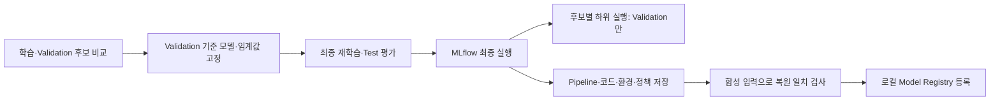

# 은행 고객 이탈 예측 — 고객 선별과 재현 가능한 평가

수업의 Bank Churn 실습을 기반으로, 제한된 연락 예산 안에서 이탈 위험 고객을 선별하는 개인 포트폴리오입니다. 이탈 예측 프로젝트이며 이상거래 탐지는 다루지 않습니다.

## 이번 개인 고도화 (2026-10-29)

| 기존 문제 | v2 변경 |
|---|---|
| 후보 모델마다 Test 점수 확인, Validation/Test 평균 표시 | Validation에서만 모델·임계값 선택, 최종 재학습 모델이 Test에서 한 번만 예측 |
| 파생변수 함수가 학습·신규 고객 처리에 따로 존재 | 원시 컬럼 → 파생변수 → 결측값·인코딩·스케일링 → 분류기를 Pipeline 하나로 저장 |
| baseline 선정 후에도 FE 입력으로 재학습할 가능성 | 선택한 Pipeline 전체를 clone/refit해 baseline/FE 설정을 보존 |
| AUC 중심 결과 | 상위 10% Precision·Recall·Lift와 AP, F2·혼동행렬을 함께 기록 |
| 개인 컴퓨터 절대 경로 의존 | 경로를 받는 CLI와 같은 모듈을 호출하는 노트북 |
| 고객별 데이터·점수·모델이 Git에 포함 | 현재 버전에서는 제외, 집계 지표와 재현 가능한 합성 데이터 생성 코드만 공개 |

제공 실습을 기반으로 한 응용이며 전체를 독자 작성했다고 주장하지 않습니다. `모델개발및최적화.ipynb`, 과거 발표 대본과 `reports/historical-v1.csv`는 기존 기록입니다. 현재 실행 경로는 `churn/`이며 과거 점수와 새 점수를 동일 조건의 개선율로 비교하지 않습니다.

## 빠른 실행 — API 키·GPU 불필요

Python 3.11 환경에서 프로젝트 루트 기준:

```bash
python3.11 -m venv .venv
source .venv/bin/activate
python -m pip install -r requirements.txt
python -m churn.demo --output data/demo.csv --rows 1000
python -m churn.train train --data data/demo.csv --output artifacts/demo-run
python -m unittest discover -s tests -v
```

위 demo는 직접 생성한 가상 데이터입니다. 실행 확인용이며 아래 실제 교육 데이터의 결과를 재현하지 않습니다. 이미 존재하는 데이터·실험 폴더·출력 파일은 덮어쓰지 않습니다. 반복할 때 새 출력 이름을 지정하세요. 외부 API·네트워크 호출은 학습·평가 코드에 없습니다.

## 교육 데이터로 학습·신규 고객 처리

이용 가능한 교육용 `bank_churn_train.csv`, `bank_churn_new.csv`를 `data/`에 별도로 준비합니다. 교육용 날짜 컬럼이 추가된 자료라 다른 Bank Churn 공개 CSV와 스키마가 같다고 가정하지 않습니다. 기존 체크아웃에 남아 있는 루트 CSV는 `--data bank_churn_train.csv`로 사용할 수 있습니다.

```bash
python -m churn.train train --data data/bank_churn_train.csv --output artifacts/bank-run
python -m churn.train score --data data/bank_churn_new.csv --model artifacts/bank-run/model.joblib --output outputs/new-customer-scores.csv
```

학습에는 `Exited`(0=유지, 1=이탈)와 고유한 `CustomerId`가 필요합니다. 같은 고객의 여러 스냅샷을 무작위로 나누지 않도록 중복 ID는 거부합니다. 점수화에는 정답이 필요 없으며 ID는 출력 매칭에만 사용합니다. 모델이 사용하는 컬럼은 다음과 같습니다.

- 수치: CreditScore, Age, Balance, NumOfProducts, HasCrCard, IsActiveMember, EstimatedSalary
- 범주: Geography, Gender
- FE 사용 시 날짜: baseDate, accountOpeningDate

성씨·ID·정답·예상하지 않은 추가 컬럼은 입력에서 제외합니다. 날짜 해석 실패·미래 개설일·0 이하 나이의 파생값은 결측값으로 처리하고, 학습 데이터에서 학습한 대체값을 사용합니다. 필수 컬럼 누락·잘못된 수치·무한대 입력은 실패시킵니다. 처음 보는 범주도 처리합니다.

출력의 `churn_score`는 보정된 실제 이탈 확률을 보장하지 않는 모델 점수입니다. `risk_flag`는 Validation F2 기준 임계값을 넘는지 표시하고, `contact_selected`는 점수가 높은 순서대로 **floor(고객 수 × 연락 비율)**명만 선택합니다. 두 정책을 같은 것으로 해석하지 않습니다. 동점은 입력 행 순서를 사용하며, 10명 미만에서 10% 예산은 0명입니다. 고객별 점수와 joblib은 로컬에만 저장합니다. joblib 로딩은 본인이 생성한 신뢰할 수 있는 파일에만 사용하세요.

## 평가 절차

1. seed 42, 고객 단위 단일 스냅샷을 층화 60/20/20으로 분리합니다.
2. Train에서 Logistic Regression, RF baseline, 같은 RF+FE, 얕은 RF+FE, XGBoost+FE를 학습합니다. 자동 대규모 탐색은 하지 않습니다.
3. Validation의 상위 10% Precision → AP → ROC-AUC 순으로 모델을 선택합니다. 동률이면 모델 이름 순입니다. baseline/FE RF는 같은 설정으로 비교합니다.
4. 선택 후보의 Validation 점수에서 F2를 최대화하는 임계값을 고정합니다. 동률이면 높은 임계값을 사용합니다.
5. 선택 Pipeline을 Train+Validation으로 재학습하고, Test에서 한 번만 예측합니다. Test는 후보 선택·임계값 조정·조기 종료에 쓰지 않습니다.
6. 같은 고정 Test 예측으로 지표·95% bootstrap 구간·5/10/20% 예산 곡선을 계산합니다. 이 곡선은 사후 설명용이며 Test 결과를 보고 정책을 재조정하지 않습니다.

AP는 average precision이며 사다리꼴 적분 PR-AUC와 동일하지 않습니다. preprocessing 일관성과 데이터 분리는 [scikit-learn 공식 권고](https://scikit-learn.org/stable/common_pitfalls.html)를 참고했고, 분류 지표는 [공식 평가 문서](https://scikit-learn.org/stable/modules/model_evaluation.html)를 참고했습니다.

## 이번 실행 결과 — 교육 데이터 2,100명

집계 결과 전체: [reports/churn-v2.json](reports/churn-v2.json). 같은 seed의 기존 데이터로 새 절차를 실행한 후향 분석입니다. 개인별 예측은 포함하지 않습니다.

| Validation 후보 | 상위 10% Precision | AP | ROC-AUC |
|---|---:|---:|---:|
| XGBoost + FE (선택) | 0.8095 | 0.7194 | 0.8771 |
| 얕은 RF + FE | 0.7619 | 0.6433 | 0.8419 |
| RF + FE | 0.7381 | 0.6487 | 0.8548 |
| RF baseline | 0.7143 | 0.6340 | 0.8600 |
| Logistic Regression + FE | 0.5238 | 0.5014 | 0.7727 |

최종 Test는 420명(이탈 89명)입니다. 최종 모델은 XGBoost + FE이며 Train+Validation 1,680명으로 재학습했습니다.

| 최종 Test 지표 | 결과 |
|---|---:|
| ROC-AUC | 0.8568 |
| Average Precision | 0.6789 |
| 상위 42명 중 실제 이탈 고객 | 34명 |
| Precision@10% | 80.95% |
| Recall@10% | 38.20% |
| Lift@10% | 3.82 |
| 무작위로 42명 선택 시 기대 이탈 고객 수 | 8.9명 |

Validation에서 선택한 F2 임계값은 약 0.1785입니다. 이 임계값 정책의 Test Precision은 44.30%, Recall은 78.65%로, 연락 예산 10% 정책과 다른 결과입니다. Test ROC-AUC의 bootstrap 95% 구간은 약 0.8140~0.8998이며 학습·모델 선택 변동성을 포함하지 않습니다.

신규 고객 900명을 저장한 모델로 별도 점수화해 원시 입력 호환성을 확인했습니다. 신규 고객의 정답은 평가하지 않았으며 신규 데이터 정확도 검증을 의미하지 않습니다.

## 검증과 한계

검사 8종: 개인정보·정답의 입력 제외, 결측/처음 보는 범주/잘못된 날짜, 스키마·무한대 입력 거부, 추론 시 전처리 재학습 방지, baseline/FE 저장·복원 일치, 연락 예산·동점 규칙, 분할 격리·최종 모델만 Test 접근, 고객 중복·라벨 검증. 검사에는 합성 자료만 사용합니다.

- 이 데이터는 이전 실습에서 이미 탐색했습니다. 절차를 고쳐도 완전히 새로운 외부 홀드아웃이 되지는 않습니다.
- 기준일이 하나인 스냅샷 자료라 미래 시점 성능을 입증하지 않습니다. 새로운 기간·고객 cohort를 별도로 평가해야 합니다.
- Validation에서 연락 대상은 42명뿐이라 모델 선택이 불안정할 수 있습니다. 단일 split의 우승을 보편적인 우위로 확대하지 않습니다.
- 이탈 위험과 캠페인 반응은 다릅니다. 연락 효과·고객 유지 수익·비용 정보가 없어 uplift나 실제 순이익은 주장하지 않습니다.
- 원본 CSV·고객별 출력·모델·과거 제출 바이너리는 현재 추적에서 제외했습니다. **기존 공개 커밋에서 소급 삭제한 것은 아닙니다.** 로컬 파일은 보존했습니다.

다음 개선 후보는 시간 기준 신규 데이터 검증, 반복 분할에서의 선택 안정성, 점수 보정, 캠페인 효과 데이터 기반 의사결정입니다. 우선은 현재 절차와 공개 결과를 재현할 수 있게 유지합니다.


## 개인 고도화 2 — 로컬 MLflow 실험·모델 관리

2026-10-29에 수업에서 다룬 MLflow Tracking·Model Registry 흐름을 연결했습니다. 기존 학습·평가가 끝난 뒤 기록을 시작하며, Tracking을 선택하지 않으면 기존 CLI 그대로 동작합니다. 이번 단계는 모델 관리이며 FastAPI 서빙·실제 배포를 의미하지 않습니다.



### 설치와 실행

기본 의존성과 별도로 MLflow 3.16.0을 설치합니다. API 키·클라우드 계정은 필요 없습니다.

```bash
python -m pip install -r requirements-tracking.txt
python -m churn.train train --data data/demo.csv --output artifacts/demo-tracked --tracking-dir artifacts/mlflow --experiment bank-churn-demo
python -m churn.tracking --run-dir artifacts/demo-tracked --tracking-dir artifacts/mlflow --experiment bank-churn-demo
```

`data/demo.csv`는 앞 절의 `churn.demo` 명령으로 생성합니다. 실데이터를 준비했다면 `--data`와 실험 이름을 변경합니다. 같은 출력 폴더를 재사용하지 않습니다. 노트북에서도 `CHURN_TRACKING_DIR=artifacts/mlflow`를 설정하면 같은 모듈을 통해 기록합니다.

별도 터미널에서 프로젝트 루트를 열고 화면을 실행합니다.

```bash
source .venv/bin/activate
export MLFLOW_DISABLE_TELEMETRY=true
export MLFLOW_ENABLE_OTLP_EXPORTER=false
export MLFLOW_DISABLE_AGENT_HINT=1
mlflow ui --backend-store-uri sqlite:///artifacts/mlflow/tracking.db --host 127.0.0.1 --port 5055 --workers 1
```

브라우저 주소: `http://127.0.0.1:5055`. 종료는 해당 터미널에서 Ctrl+C입니다. Tracking 프로그램은 SQLite DB와 file 아티팩트 경로를 직접 지정하므로 UI 서버가 꺼져 있어도 기록·등록·복원 검사를 실행할 수 있습니다. 기존 원격 Tracking/Registry 환경변수는 이 로컬 실행에서 사용하지 않습니다.

### 화면에서 확인할 것

- **Experiments → bank-churn**: `selected-final` 상위 실행과 후보 5개의 하위 실행을 봅니다. `phase=candidate` 실행의 `validation_precision_at_budget`, `validation_average_precision`, `validation_roc_auc`를 비교합니다. 후보 실행에 Test 지표는 기록하지 않습니다.
- **selected-final**: 데이터 SHA-256, seed, 분할 건수·방법, 선택 기준, F2 임계값, 최종 Test 지표와 `report.json`을 확인합니다.
- **Models → BankChurnPipeline**: 선택된 Pipeline의 버전과 코드·환경 명세를 확인합니다. `deployment=not_deployed`이며 production/champion 별칭을 자동 부여하지 않습니다.
- **decision_policy.json / 모델 metadata**: 임계값·연락 비율을 별도로 보존합니다. sklearn 모델의 기본 `predict()` 결과를 이 정책의 risk_flag로 혼동하지 않습니다. MLflow pyfunc flavor는 두 클래스의 `predict_proba`를 반환하도록 설정했습니다.

### 저장·검증·보안 범위

`artifacts/mlflow/tracking.db`에 실행·등록 메타데이터, 같은 폴더 아래 `artifacts/`에 Pipeline·애플리케이션 코드·환경·집계 결과를 저장합니다. 실행 폴더의 `mlflow.json`은 로컬 run ID와 고정 Registry 버전을 연결합니다. 이 파일과 MLflow DB·모델은 Git에 올리지 않습니다.

원본 고객 행·개인별 점수·고객 ID·성씨를 로그하지 않고, autologging·input_example·원본 데이터셋 로깅도 사용하지 않습니다. 모델 signature는 실제 고객 대신 직접 생성한 합성 입력 8행으로 구성합니다. 원격 아티팩트 URI나 지정 Tracking 폴더 밖을 가리키는 기존 실험은 거부합니다. SDK와 UI의 사용량 telemetry는 끕니다.

직접 작성한 전처리 클래스를 포함하므로 모델은 cloudpickle 형식으로 저장합니다. 기존 joblib과 마찬가지로 **본인이 생성한 신뢰할 수 있는 로컬 아티팩트만 로드**합니다. 이 버전의 MLflow 기본 skops 형식에서는 사용자 정의 전처리의 신뢰 타입 검토가 별도로 필요합니다. 이 앱은 신뢰할 수 없는 모델을 받는 업로드 기능을 제공하지 않습니다.

합성 입력에서 원본 Pipeline, MLflow 아티팩트 복원본, 고정 Registry 버전 복원본의 점수가 atol=1e-12 안에서 일치해야 합니다. 첫 복원 검사가 실패하면 Registry 버전을 생성하지 않으며, 기록 도중 실패한 실행은 FAILED로 남습니다. 학습·평가 도중 실패를 실시간으로 추적하는 기능은 아직 없습니다.

이번 실행의 공개 집계 검증: [reports/mlflow-verification.json](reports/mlflow-verification.json).

- MLflow 설치 환경에서 **검사 12개 통과**, integration 검사 생략 0개. Tracking 의존성이 없으면 기본·경로 검사 9개만 실행하고 MLflow 통합 검사 3개는 생략합니다.
- 교육 데이터 실험에서 후보 실행 5개 + 최종 실행 1개, 후보의 Test 지표 기록 0개를 확인했습니다. 기존 v2와 최종 Test 집계 지표도 일치했습니다.
- 아티팩트·Registry 복원 및 별도 Python 프로세스 재검증의 최대 점수 차이는 **0.0**이었습니다. 합성 입력의 직렬화 일치 검사이며 미래 고객 성능을 증명하지 않습니다.
- MLflow UI와 실험 목록 조회의 HTTP 200을 확인했습니다. MLflow 검증 환경은 로컬 macOS/ARM64, Python 3.14.7입니다. 기존 v2 학습 결과의 Python 3.11 환경과 구분합니다.

참고: [MLflow Tracking](https://mlflow.org/docs/latest/ml/tracking/quickstart/), [sklearn 모델 저장](https://mlflow.org/docs/latest/api_reference/python_api/mlflow.sklearn.html), [Model Registry](https://mlflow.org/docs/latest/ml/model-registry/workflow/), [telemetry 설정](https://mlflow.org/docs/latest/community/usage-tracking/).
